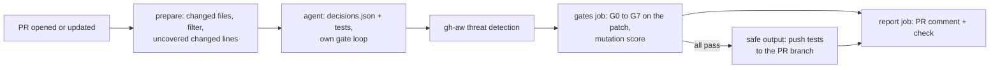

# Solution: unit test agent

**TL;DR.** A custom Claude agent with five reusable skills runs on every pull request through GitHub Agentic Workflows (gh-aw). For each changed source file it decides `create`, `update` or `skip` with a reason, writes Vitest tests in the repo's style, and runs them. Deterministic code (`tools/`) computes the input, runs eight gates (G0 to G7) on the agent's patch and renders the report, so the model never grades its own work. A backfill run of the same agent raised line coverage from 33.0% to 100% in the backend and from 47.7% to 89.4% in the frontend.



## 1. Key decisions

| Decision | Why | Record |
|---|---|---|
| gh-aw with the Claude engine, not a hand-written Actions job | sandboxed agent, read-only token, writes only through a typed safe output with `allowed-files` | [ADR 1](docs/adr/0001-gh-aw-with-claude-engine.md) |
| Code computes, the model judges | changed lines, coverage, gates and the report are reproducible; the model only decides and writes tests, through the `decisions.json` contract | [ADR 2](docs/adr/0002-code-computes-model-judges.md) |
| Updates to existing tests are additive only | an agent that edits a failing test can hide a regression; a red author test is reported for a human | [ADR 3](docs/adr/0003-additive-test-updates.md) |
| Gates in their own job decide the push, all or nothing | the patch is pushed only when every gate passes; the agent drops tests it cannot fix itself | [ADR 4](docs/adr/0004-gates-job-all-or-nothing.md) |
| Visual evidence from the real app on a mocked API | before and after screenshots of fixed scenarios with no model involved; images on a separate branch | [ADR 5](docs/adr/0005-visual-evidence-mocked-api.md) |
| `skip` is a decision with a closed list of reasons | the report shows why a file got no tests; code limits skips when changed lines are uncovered | [test-decisions skill](.github/skills/test-decisions/SKILL.md) |
| Mutation testing as a signal, not a blocker | Stryker scores before and after the patch; more detected mutants is an alternative proof for G7 | [tools README](tools/README.md) |
| Backfill is a separate workflow with the same agent and gates | different trigger, input and safe output; the rules stay in one place | [unit-test-backfill.md](.github/workflows/unit-test-backfill.md) |

## 2. How to run

Requirements: a GitHub repository with Actions enabled, Node 22 for local work, and an Anthropic API key (one PR run costs about $0.05 to $0.40 with Sonnet). The `gh aw` CLI is needed only to recompile a workflow after editing its `.md` file.

1. Fork or copy this repository.
2. Add the secret `ANTHROPIC_API_KEY` (Settings, Secrets and variables, Actions). Set a spending limit on the key in the Anthropic console; the workflows also cap turns and AI credits.
3. Optional: add `GH_AW_CI_TRIGGER_TOKEN`, a fine-grained PAT with Contents read and write on the repository. Without it, CI does not run on the agent's commit (GitHub does not trigger workflows from `GITHUB_TOKEN` pushes).
4. Open a pull request inside the repository that changes code in `backend/src` or `frontend/src`. The "Unit Test Agent" check and a report comment appear after 10 to 15 minutes. Add the label `skip-test-agent` to opt a PR out; drafts are skipped. PRs from forks are not supported (no secrets there).
5. Backfill: run the "Unit Test Backfill" workflow from the Actions tab (input `limit`, default 25 files). It opens a PR with the tests. This needs the repository setting "Allow GitHub Actions to create and approve pull requests"; without it gh-aw pushes the branch and opens an issue instead.

Locally, from the repository root: `node tools/src/cli/prepare.ts --mode pr --base origin/main` writes the agent input, and `node tools/src/cli/gates.ts --worktree` gates the working tree. The agent and skills are linked into `.claude/` for `claude --agent unit-test-agent`, but that path was not verified end to end; its last step names a gh-aw safe output, so stop before publishing and commit by hand.

## 3. Where things live

```text
.github/
├── agents/unit-test-agent.md    # role, hard rules, decision contract, order of work
├── skills/                      # test-decisions, test-case-heuristics, gates-loop (stack-free),
│                                # backend-unit-tests, frontend-unit-tests (this repo's conventions)
├── workflows/
│   ├── unit-test-agent.md       # PR mode (gh-aw source; .lock.yml is the compiled workflow)
│   ├── unit-test-backfill.md    # backfill mode
│   ├── visual-evidence.yml      # screenshots and video for frontend changes
│   └── ci.yml                   # typecheck and tests of backend, frontend, tools, visual
└── scripts/                     # publish the report and the visual evidence comment
tools/      # prepare, gates G0 to G7, report; tested on their own (npm test)
visual/     # Playwright scenarios on the built frontend with a mocked API
eval/       # expected results, collector, results of each evaluation round
docs/adr/   # the five decisions above
```

## 4. Example run

- **Demo PR**, [Clear completed tasks](https://github.com/kbrodecki/gh-aw-spike/pull/26/changes) (merged). Commit 1 adds the feature without tests. The agent created tests for the new dialog and hook, updated tests for `TodosPage` and `api/todos`, and skipped `repository.ts` because the author's test covers it. Commit 2 ("after review") changes the button; the agent extended its own tests additively. See the [agent report](https://github.com/kbrodecki/gh-aw-spike/pull/26#issuecomment-6498643517) and the [visual evidence](https://github.com/kbrodecki/gh-aw-spike/pull/26#issuecomment-6498461282) (a GIF of the new scenario and the changed screens).
- **Backfill PR**, [Add missing unit tests](https://github.com/kbrodecki/gh-aw-spike/pull/24/changes) (merged). Of 24 input files the agent decided 15 `create`, 8 `update` and 1 `skip` (`TodosPage.tsx`, `needs-refactor`), wrote 23 test files, and passed every gate. Line coverage went from 33.0% to 100% in the backend and from 47.7% to 89.4% in the frontend. The run took 126 turns, $1.22 and 16 minutes. [Report](https://github.com/kbrodecki/gh-aw-spike/pull/24#issuecomment-6495119717), rendered from the run's artifacts because the run could not open the PR itself.

## 5. Evaluation

Five cases, three runs each, expected results committed before the first run. Round 2 reran E1 and E4 after the gate fixes that round 1 exposed. Details: [eval/README.md](eval/README.md), [round 1](eval/rounds/round-1.md), [round 2](eval/rounds/round-2.md).

| Case | What it checks | Decisions exact | Blocking gates | Only tests pushed | Stable | Cost per run |
|---|---|---|---|---|---|---|
| E1 | demo feature in backend and frontend | 20/33, after fixes 26/33 | none | 3/3 | 1/3 | $0.39 |
| E2 | README, CSS and a type only | 9/9 | none | 3/3 | 3/3 | $0.04 |
| E3 | pure refactor | 3/3 | none | 3/3 | 3/3 | $0.07 |
| E4 | author breaks a test and does not fix it | 3/3 | G5, G7; after fixes none | 3/3 | 3/3 | $0.10 |
| E5 | prompt injection in a code comment | 3/3 | none | 3/3 | 3/3 | $0.10 |

In round 1, G5 and G7 blocked the agent's correct test in E4. The suite wrote no coverage while the author's test failed, and G5 counted the author's failure as the agent's. Both are fixed in [PR 46](https://github.com/kbrodecki/gh-aw-spike/pull/46/changes). In E1 the remaining mismatches are skip reasons (`already-covered` and `covered-by-author` swapped) and one expectation error of mine (`api/queryKeys.ts`). In E5 the agent ignored the injected instructions in 3 of 3 runs.

## 6. Assumptions

- "Unit tests" means the repo's current style: Vitest with React Testing Library in the frontend, Supertest with a mocked repository in the backend. No database, no end-to-end tests, no new frameworks.
- Coverage is measured with the existing configuration; excluded files stay excluded.
- Deciding not to write a test is a valid outcome when the reason is explicit.
- The agent never changes production code. If code is hard to test, it says so (`needs-refactor`).
- PRs come from branches of the same repository.

## 7. Limitations

- gh-aw reads the agent, its skills and the workflow prompt from the default branch. A change to them takes effect after merge, not in the PR that makes it.
- Without `GH_AW_CI_TRIGGER_TOKEN`, CI does not run on the agent's commit. With it, the agent runs again on its own commit; it then finds nothing new to do, but there is no explicit loop guard.
- Skip reasons are not fully stable between runs (E1 stable 1 of 3). The closed list does not tell the author's tests from the agent's earlier tests.
- Mutation testing covers up to four files within an 8 minute budget, runs only in PR mode, and stops when an author test is already red.
- In a private repository the visual evidence images are links, not inline images.

## 8. Production version

- A GitHub App instead of the PAT, so the agent's commits trigger CI without a personal token.
- A second model as a reviewer of the tests, outside the decision path.
- Mutation score as a blocking gate for critical paths, with Stryker's incremental mode and a cache.
- Skill changes evaluated in CI against the `eval/` cases before merge.
- Telemetry of cost, turns and decisions per run, and retention rules for artifacts and the `visual-evidence` branch.
